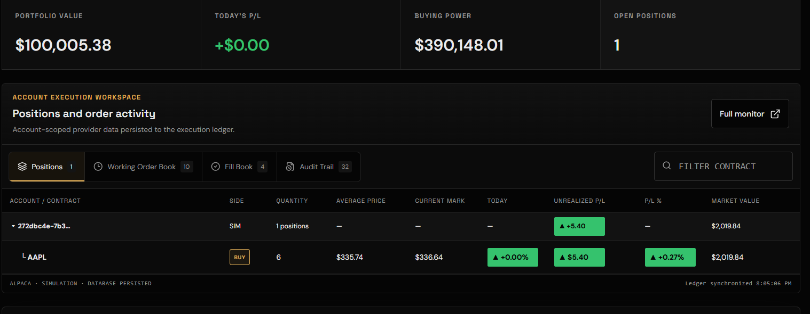
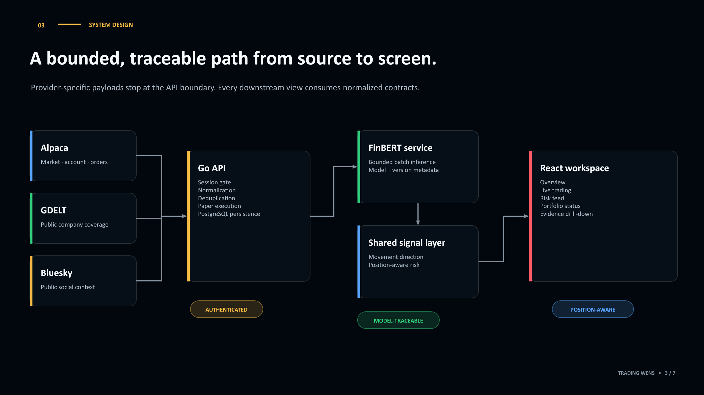

# Trading Wens - S&P Global & Crisil Campus Hackathon

**Candidate Name:** Shivansh Dwivedi<br>
**College Email ID:** bt23cse124@iiitn.ac.in<br>
**College / Campus:** IIIT Nagpur<br>
**Demo Video Link:** Pending unlisted YouTube upload<br>
**Slide Deck Link:** [PDF](docs/presentation.pdf) · [PowerPoint](docs/presentation.pptx)

Trading Wens is a decision-support workspace for paper trading. It brings live market snapshots, account positions, company news, trained financial sentiment, directional signals, and position-aware risk into one authenticated interface. The aim is not to automate investment decisions. It is to reduce the time between a market event and a reasoned, auditable response.

## 1. Project Overview / Problem Statement & Approach

Market data, news, portfolio exposure, and execution records usually live in separate tools. That fragmentation makes it hard to answer a practical question quickly: *what changed, what might it mean for my current position, and what should I inspect before placing a trade?* A raw positive headline is also not enough. The same predicted move can reduce risk for one position and increase risk for another.

Trading Wens connects those signals. The Go API aggregates authenticated Alpaca paper-trading data with public GDELT coverage, sends eligible headlines to a locally hosted FinBERT classifier, and exposes normalized, versioned responses to a React dashboard. Directional prediction is derived from current market movement and available sentiment evidence. Portfolio risk then applies that prediction to the sign and size of each real open position.

The result is one workspace for account overview, order entry, live risk review, news evidence, and portfolio-level exposure. Orders remain explicitly confirmed paper orders. Missing providers or model output are shown as unavailable instead of being replaced with invented values.



## 2. Architecture & Tech Stack



1. The authenticated React workspace requests versioned `/api/v1` resources through the Vite proxy.
2. The Go service validates the signed session and loads account, market, order, news, and social data from their owning providers.
3. Alpaca and GDELT news records are normalized and deduplicated by URL.
4. Eligible headlines are sent in bounded batches to the local FinBERT inference service.
5. The API returns article-level sentiment with model metadata and normalized market/account contracts.
6. Shared frontend signal logic turns the evidence into a movement label, confidence, and risk contribution for each open position.
7. Order, fill, audit, and provider snapshots are persisted in PostgreSQL for traceability.

**Technology stack:** React 19, TypeScript, TanStack Router, Vite, Go, PostgreSQL, Python, PyTorch, Transformers, FinBERT, Alpaca Paper Trading, GDELT, and Bluesky Public AppView.

Detailed design decisions and contracts are documented in [docs/architecture.md](docs/architecture.md), [docs/api-v1.yaml](docs/api-v1.yaml), and [docs/system-design.md](docs/system-design.md).

## 3. Dataset Used

Runtime data comes from authorized or public sources:

- **Alpaca:** authenticated US-equity snapshots, bars, paper account, positions, orders, fills, and available news.
- **GDELT DOC 2.0:** public company news coverage and source URLs.
- **Bluesky Public AppView:** recent public stock conversation, presented separately from trained news sentiment.
- **Trading Wens demonstration fixtures:** clearly labelled synthetic market and risk examples used when demonstrating the public experience.

No proprietary dataset or secret is committed. Live provider payloads remain at the provider boundary. The submission includes only compact synthetic CSV/JSON samples for reproducible charts and examples:

- [Synthetic sentiment history](data/synthetic-sentiment-history.csv)
- [Synthetic risk events](data/synthetic-risk-events.json)
- [Data-source register](data/data-sources.json)
- [Dataset assumptions](data/README.md)

The sentiment checkpoint is a separately trained financial-language model. Model weights are not committed because they are generated deployment artifacts and exceed normal Git hosting limits. The inference contract requires `model.safetensors`, tokenizer files, `labels.json`, and `calibration.json` in the configured checkpoint directory.

## 4. Quickstart & Installation

**Runtime tested:** Node.js 20+, Go 1.23, and Python 3.11+ on Windows 11.

### Prerequisites

- Node.js 20 or newer and pnpm 11
- Go compatible with `src/backend/go.mod`
- Python 3.11 or newer
- PostgreSQL database
- Alpaca paper-trading credentials
- A compatible local FinBERT checkpoint

### Setup

```powershell
git clone https://github.com/ShivanshDwivedi2005/Trading-Wens.git
cd Trading-Wens
pnpm install
Copy-Item .env.example .env
Copy-Item src\frontend\.env.example src\frontend\.env

python -m venv src\ml\.venv
.\src\ml\.venv\Scripts\Activate.ps1
python -m pip install -r requirements.txt
```

Fill the local environment files with your own credentials. Apply `src/backend/migrations/001_trading_ledger.sql` and `src/backend/migrations/002_password_auth.sql` to PostgreSQL in that order. Never commit `.env` files or model weights.

Start the three runtime processes in separate terminals:

```powershell
# Trained sentiment service
.\src\ml\.venv\Scripts\python.exe src\ml\inference\server.py

# Go API
Set-Location src\backend
go run ./cmd/api

# React frontend, from repository root
pnpm dev
```

Open `http://127.0.0.1:3000`. Health endpoints are available at `http://127.0.0.1:8080/health` and `http://127.0.0.1:8090/health`.

Run the verification suite before submission:

```powershell
pnpm check
Set-Location src\backend
go test ./...
```

Configuration sources and acquisition steps are documented in [docs/configuration.md](docs/configuration.md).

## 5. Key Results and Domain Impact

- Maintains a 30-stock large-cap universe while overlaying every available open Alpaca position.
- Aggregates up to 50 normalized articles per request and sends at most 16 headlines per inference batch.
- Refreshes portfolio, order, and risk views after order activity so newly filled symbols are not limited to a hard-coded ticker.
- Uses one shared directional prediction across live trading, risk feed, stock analysis, and portfolio exposure.
- Applies direction to position sign: a predicted fall is adverse for a long position but favorable for a short position, and vice versa.
- Preserves order, fill, audit, and model evidence for review rather than presenting a black-box trade instruction.
- Keeps public demo fixtures explicitly synthetic and live provider data explicitly authenticated.

For the S&P Global and Crisil domain, the project demonstrates how normalized provider data and financial-language models can support faster surveillance without hiding uncertainty. The same architecture can extend to credit events, index constituents, issuer monitoring, or analyst workflows while retaining source and model traceability.

## Repository Structure

```text
Trading-Wens/
├── README.md
├── LICENSE
├── requirements.txt
├── src/
│   ├── frontend/        React authenticated workspace
│   ├── backend/         Go API, domain logic, migrations, tests
│   └── ml/              Local FinBERT inference service
├── data/                Submission-safe CSV/JSON samples
└── docs/
    ├── presentation.pptx
    ├── presentation.pdf
    ├── architecture.png
    ├── images/
    └── design and API documentation
```

## Demo Video Plan

The final recording should be no longer than ten minutes and should show: sign-in, account overview, a paper market order, the refreshed position, trained news sentiment, movement prediction, individual and overall portfolio risk, and the order audit trail. Upload it as an unlisted YouTube video and replace the pending entry at the top of this README.

## Limitations and Next Steps

- Directional prediction is decision support, not a guarantee or investment recommendation.
- Accuracy depends on provider availability, symbol relevance, checkpoint calibration, and the latency of source publication.
- Portfolio risk is currently an interpretable exposure heuristic rather than a full VaR or stress-testing engine.
- Next steps are walk-forward evaluation, event clustering, calibrated neutral thresholds, WebSocket updates, and production monitoring for model drift and provider health.

## Submission Access Checklist

- [x] Add the confirmed IIIT Nagpur college email address.
- [ ] Add the unlisted YouTube demo URL.
- [ ] Rename the public repository to `iiit-nagpur-shivansh-dwivedi-hackathon`.
- [ ] Confirm the repository opens in a private/incognito window without authentication.
- [ ] Confirm the YouTube video is viewable without requesting access.
- [ ] Confirm `docs/presentation.pdf` and `docs/presentation.pptx` open from this README.
- [ ] Run `pnpm check` and `go test ./...` from a clean clone.
- [ ] Verify no `.env`, credential, model-weight, dependency, or generated-build files are staged.

## Academic Integrity

This repository contains original implementation work for a single-candidate hackathon submission. External APIs, libraries, model families, and design media are named in the repository and presentation. No confidential S&P Global or Crisil information is included. The application is a research and simulation aid, not investment advice.

## License

Released under the [MIT License](LICENSE).
